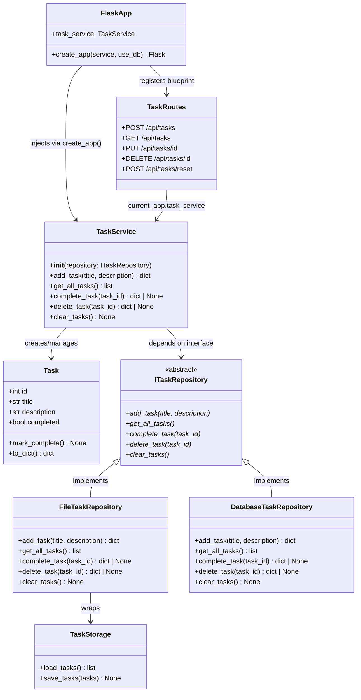

# Class Diagram — Current Sprint: Sprint 4

> **Living document.** Updated when architecture changes. See `docs/checkpoints/` for snapshots.  
> **Last updated:** S4_1

---

## Key Relationships

| Relationship | From | To | Type |
|---|---|---|---|
| Interface | `ITaskRepository` | `FileTaskRepository` | Inheritance (implements ABC) |
| Interface | `ITaskRepository` | `DatabaseTaskRepository` | Inheritance (implements ABC) |
| Dependency | `TaskService` | `ITaskRepository` | Depends on interface — not concrete class |
| Wraps | `FileTaskRepository` | `TaskStorage` | Delegation |
| Injection | `FlaskApp` | `TaskService` | Dependency Injection |

## Notes

- `TaskService` now depends on `ITaskRepository` — not `TaskStorage` directly
- `MockTaskService` (hand-rolled) is **removed** — `mocker.MagicMock()` replaces it
- `DatabaseTaskRepository` shown here but implemented in S4_2
