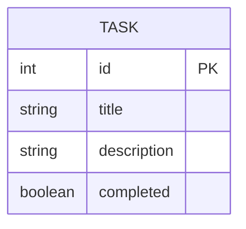

# ERD (Entity Relationship Diagram) — Current Sprint: Sprint 4

> **Living document.** Updated when data model changes. See `docs/checkpoints/` for snapshots.  
> **Last updated:** S4_1

---

> **S4_1:** ERD unchanged from Sprint 3 — file storage (`tasks.json`) remains the
> persistence backend in S4_1. `ITaskRepository` is designed so the data model
> maps directly to the database schema introduced in S4_2 with no changes required.
>
> **S4_2:** `DatabaseTaskRepository` implemented using SQLAlchemy. The `TASK`
> entity below maps directly to the `tasks` table. ERD will be updated in the
> S4_2 Update Agile Docs assignment to reflect the live database schema.

## Field Definitions

| Field | Type | Required | Notes |
|-------|------|----------|-------|
| `id` | int | Yes | Auto-assigned, unique |
| `title` | string | Yes | Cannot be empty |
| `description` | string | No | Optional |
| `completed` | boolean | Yes | Defaults to `false` |

## Sprint 4 Preview

When database integration is introduced in Sprint 4, this ERD will map directly
to a database table. The `Task` class attributes will become SQLAlchemy model
columns with minimal changes.
